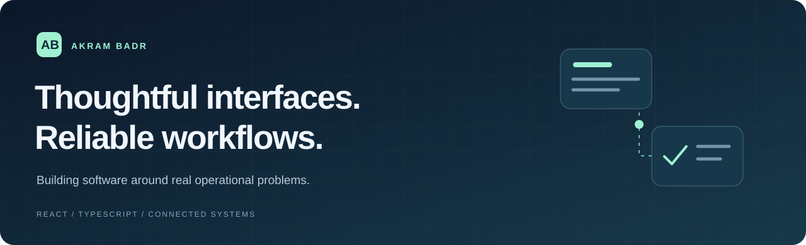
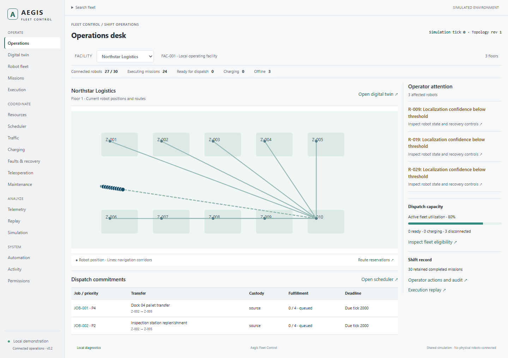
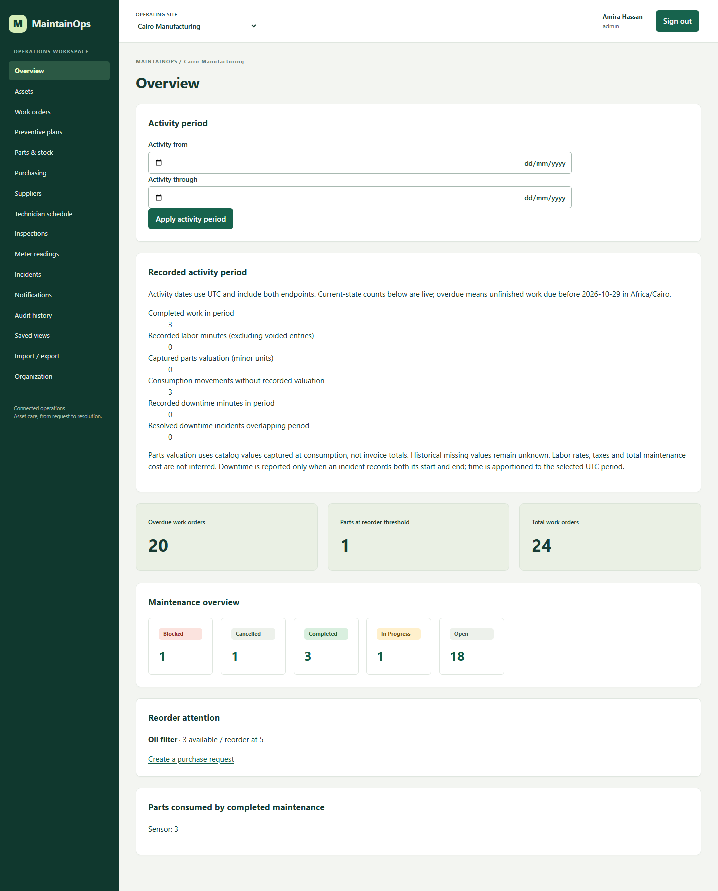
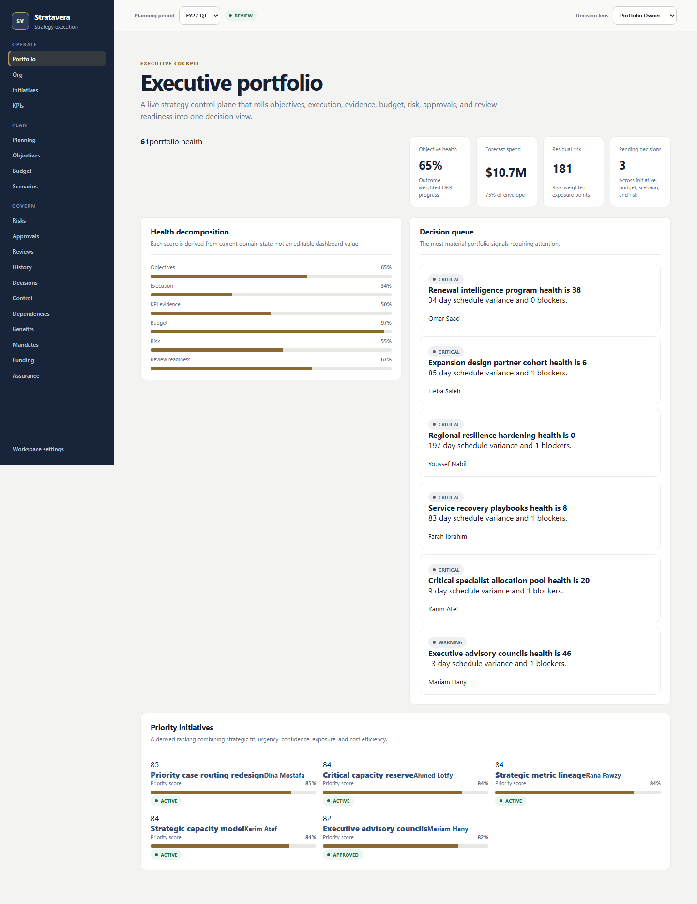
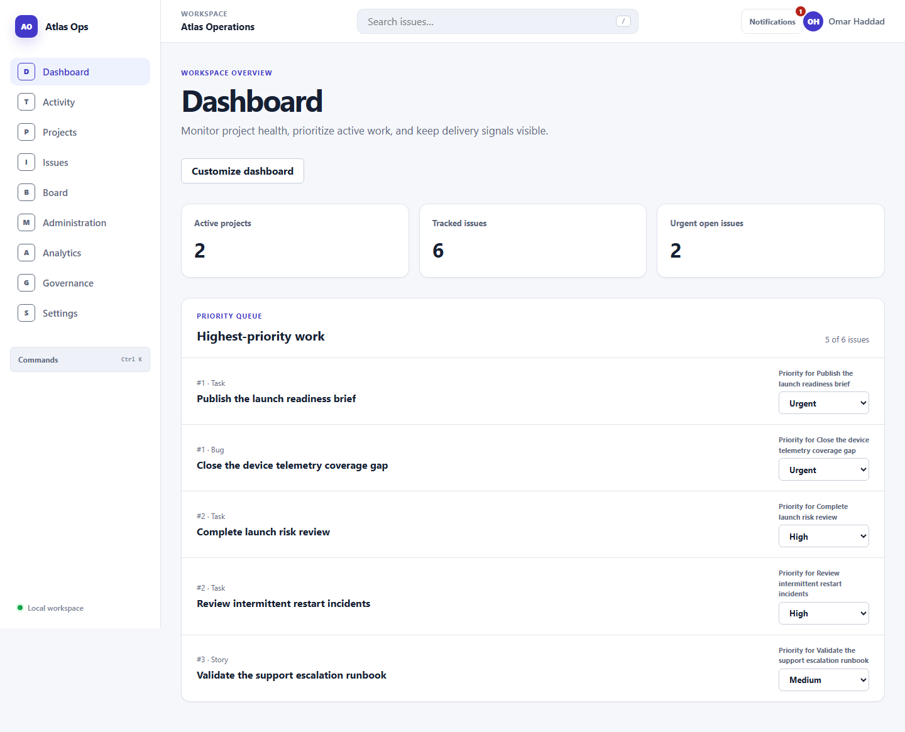

  

  <strong>Hi, I'm Akram.</strong> 
  I build applications that connect people, operational data, and the decisions between them.

  <a href="#selected-projects">Selected projects</a> ·
  <a href="#how-i-approach-software">My approach</a> ·
  <a href="#toolbox">Toolbox</a> ·
  <a href="https://github.com/Akrambadr99?tab=repositories">All repositories</a>

## What I work on

My projects explore how complex workflows can become clear, usable software:
from maintaining equipment and coordinating robot fleets to tracking delivery
and making portfolio decisions. I work across React interfaces, TypeScript
domain logic, and the data boundaries that connect them.

## Selected projects

Four places to start, each highlighting a different engineering focus.

| Project | What it explores | Engineering focus |
| --- | --- | --- |
| **[MaintainOps](https://github.com/Akrambadr99/maintainops)** | Multi-site assets, maintenance, work orders, parts, and purchasing. | React + Express + SQLite; persisted workflows and operational evidence. |
| **[Aegis Fleet Control](https://github.com/Akrambadr99/aegis-fleet-control)** | Robot fleets, missions, facility maps, traffic, and charging in a simulated environment. | Connected state transitions, resource coordination, and replay. |
| **[Stratavera](https://github.com/Akrambadr99/AmberPath)** | Strategy execution across objectives, initiatives, budgets, risks, and reviews. | Portfolio context, decision evidence, and cross-domain consistency. |
| **[Taskora](https://github.com/Akrambadr99/Taskora)** | Project planning, issue tracking, collaboration, and workflow visibility. | Accessible interactions, query coordination, and asynchronous UI behavior. |

*Stratavera is hosted in the `AmberPath` repository. Several projects share
foundation code and history; each repository documents its current scope, setup, and limits.*

### A look inside

Real application captures using local fixture data. Open a project below to see its interface.

<strong>Aegis Fleet Control · connected robot operations</strong>

[Explore the repository →](https://github.com/Akrambadr99/aegis-fleet-control)

<strong>MaintainOps · assets and maintenance execution</strong>

[Explore the repository →](https://github.com/Akrambadr99/maintainops)

<strong>Stratavera · strategy and portfolio decisions</strong>

[Explore the repository →](https://github.com/Akrambadr99/AmberPath)

<strong>Taskora · projects, issues, and team workflows</strong>

[Explore the repository →](https://github.com/Akrambadr99/Taskora)

## How I approach software

- **Start with the workflow.** Make ownership, state changes, and failure paths explicit.
- **Keep boundaries clear.** Separate presentation, domain rules, and data access.
- **Design for real interactions.** Consider keyboard use, loading, stale state, and recovery.
- **Make behavior checkable.** Use unit, integration, and browser tests where they matter.

## Toolbox

| Area | Technologies used in the featured projects |
| --- | --- |
| Interfaces | React, TypeScript, CSS, Vite |
| Navigation & state | React Router, TanStack Query |
| Services & persistence | Node.js, Express, SQLite |
| Verification | Vitest, Testing Library, Playwright, ESLint |
| Development | Git, GitHub, npm |

### Beyond web applications

[Car speed estimation](https://github.com/Akrambadr99/car-speed-estimation) is a
Python/OpenCV/YOLOv8 experiment in vehicle detection, tracking, and line-crossing
counts. It is an exploration of computer vision, not a calibrated speed-measurement product.

---

  <strong>Explore the work, then explore the details.</strong> 
  <a href="https://github.com/Akrambadr99?tab=repositories">Browse all repositories</a>

