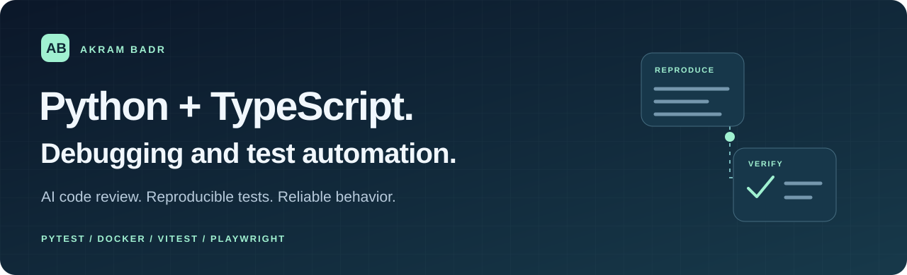
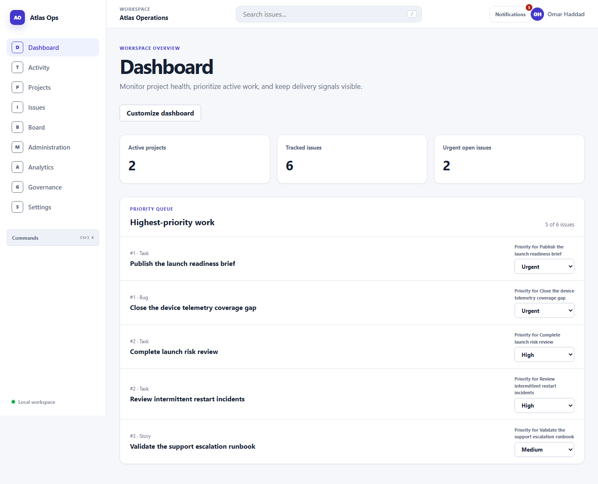

  

  <strong>Python and TypeScript engineer · AI code review · Debugging · Test automation</strong>

I'm Akram, a software engineer with **3 years of hands-on software project experience**. My professional work includes **Python-based AI coding evaluation**: reproducible debugging tasks, reference patches, and automated test harnesses. I also build **TypeScript applications** with tests for asynchronous behavior, permissions, data integrity, and recovery.

  <a href="#selected-projects">Selected projects</a> ·
  <a href="#debugging-examples">Debugging examples</a> ·
  <a href="#python-and-ai-code-evaluation">Python and AI evaluation</a> ·
  <a href="#toolbox">Toolbox</a>

## Selected projects

Start with the implementation, then follow the tests that define its behavior.

| Project | What I built | Debugging and test evidence |
| --- | --- | --- |
| **[MaintainOps](https://github.com/Akrambadr99/maintainops)** | React, Express, and SQLite workflows for assets, work orders, inventory, and purchasing. | [Login-throttling regression](https://github.com/Akrambadr99/maintainops/blob/main/tests/login-limits.test.ts) · [Transaction rollback and restart recovery](https://github.com/Akrambadr99/maintainops/blob/main/tests/persistence.test.ts) |
| **[FactoryOS](https://github.com/Akrambadr99/FactoryOS)** | A TypeScript/Node.js material-reservation service with SQLite persistence and atomic batch releases. | [Competing updates and fault-injected rollback](https://github.com/Akrambadr99/FactoryOS/blob/main/server/releaseBatchHttp.test.ts) · [Restart and migration integrity](https://github.com/Akrambadr99/FactoryOS/blob/main/server/sqliteReservationStore.test.ts) |
| **[Taskora](https://github.com/Akrambadr99/Taskora)** | A React/TypeScript project workspace with an in-memory data layer, controlled network failures, and coordinated query state. | [Optimistic-update rollback](https://github.com/Akrambadr99/Taskora/blob/main/src/app/pages/BoardPage.test.tsx) · [Conflicts, duplicate submissions, and draft recovery](https://github.com/Akrambadr99/Taskora/blob/main/src/app/pages/IssueDetailPage.test.tsx) |
| **[Aegis Fleet Control](https://github.com/Akrambadr99/aegis-fleet-control)** | A fleet simulation connecting missions, resource reservations, scoped commands, and versioned browser persistence. | [Storage failures and stale writes](https://github.com/Akrambadr99/aegis-fleet-control/blob/main/src/storage/PersistentStorageAdapter.test.ts) · [Asynchronous validation races](https://github.com/Akrambadr99/aegis-fleet-control/blob/main/src/features/missions/ValidationRace.test.tsx) |
| **[Stratavera](https://github.com/Akrambadr99/AmberPath)** | Budget transfers and approval workflows with independent voting and immutable decision history. | [Approval-renewal regressions](https://github.com/Akrambadr99/AmberPath/blob/AmberPath/src/modules/approvals/renewal.test.ts) · [Persistence and evidence validation](https://github.com/Akrambadr99/AmberPath/blob/AmberPath/src/data/approval-renewal-persistence.test.ts) |
| **[CareRoster](https://github.com/Akrambadr99/CareRoster)** | Staffing and credential workflows with dependent approvals and role-specific revalidation. | [Credential changes and approval consistency](https://github.com/Akrambadr99/CareRoster/blob/main/src/staffing/coverage-matrix/shiftLedger.test.ts) · [Saved-data validation](https://github.com/Akrambadr99/CareRoster/blob/main/src/workspace/storageValidation.test.ts) |

*Stratavera is hosted in `AmberPath`. Several projects share foundation code and history. Each repository documents its current scope, setup, and implementation boundaries.*

## Debugging examples

**Login rate limiting — MaintainOps.** Successful sign-ins were consuming the shared-network failed-login allowance. The correction separates successful logins from failed attempts, with a regression test that checks both normal access and the throttling boundary. [Test](https://github.com/Akrambadr99/maintainops/blob/main/tests/login-limits.test.ts) · [Documented correction](https://github.com/Akrambadr99/maintainops/blob/main/docs/product-expansion.md)

**Atomic recovery — FactoryOS.** A failure while recording a batch-release receipt must not leave partially changed reservations or audit events. SQLite fault-injection tests check rollback, while competing-revision and restart/retry cases exercise conflict handling and duplicate-request safety. [HTTP and transaction tests](https://github.com/Akrambadr99/FactoryOS/blob/main/server/releaseBatchHttp.test.ts)

**Asynchronous UI conflicts — Taskora.** Revision conflicts, permission changes, and network failures can arrive while a user is editing. Regression cases check optimistic rollback, preserved drafts, duplicate-submission handling, and keyboard/focus recovery. [Issue-detail tests](https://github.com/Akrambadr99/Taskora/blob/main/src/app/pages/IssueDetailPage.test.tsx)

## Python and AI code evaluation

My professional evaluation work focuses on whether a proposed code change solves the requested problem and preserves surrounding behavior.

- **Task and harness development:** Python/pytest, reproducible bug descriptions, reference diffs, and fail-to-pass/pass-to-pass contracts.
- **Repository execution:** Git states, pinned dependencies, Docker environments, and repeatable test commands.
- **Code review:** Correctness, test adequacy, edge cases, regressions, and clear technical reasons for accepting or rejecting a solution.
- **Evaluation checks:** Oracle/null controls and behavioral tests that resist hardcoded outputs.

For a public Python example, [car-speed-estimation](https://github.com/Akrambadr99/car-speed-estimation) explores YOLOv8 detection, OpenCV video processing, vehicle tracking, and directional line-crossing counts. It is an experimental computer-vision project; its speed labels are not calibrated measurements.

## How I approach a bug fix

1. Reproduce the failure and establish the expected behavior.
2. Trace the relevant state, data, and authorization boundaries.
3. Implement a focused change and add a regression test.
4. Exercise failure paths and check that surrounding behavior still holds.
5. Explain the result with code, tests, and reproducible evidence.

## Toolbox

| Area | Technologies |
| --- | --- |
| Primary languages | Python, TypeScript |
| Python engineering | pytest, FastAPI, pandas, NumPy, automation scripts |
| Application development | React, Node.js, Express, SQLite, JavaScript, CSS |
| State and navigation | TanStack Query, React Router |
| Testing | Vitest, Testing Library, Playwright, regression and integration tests |
| Reproducible workflows | Git, GitHub Actions, Docker, npm, Vite, ESLint |

## A look inside

Application captures using local fixture data.

<strong>MaintainOps · assets and maintenance execution</strong>

[Explore the repository](https://github.com/Akrambadr99/maintainops)

<strong>Aegis Fleet Control · simulated robot operations</strong>

[Explore the repository](https://github.com/Akrambadr99/aegis-fleet-control)

<strong>Taskora · projects and team workflows</strong>

[Explore the repository](https://github.com/Akrambadr99/Taskora)

<strong>Stratavera · strategy and portfolio decisions</strong>

[Explore the repository](https://github.com/Akrambadr99/AmberPath)

[Browse all repositories](https://github.com/Akrambadr99?tab=repositories)
