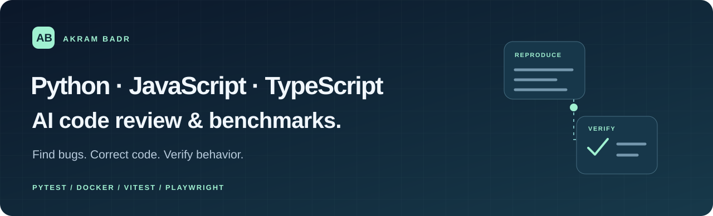
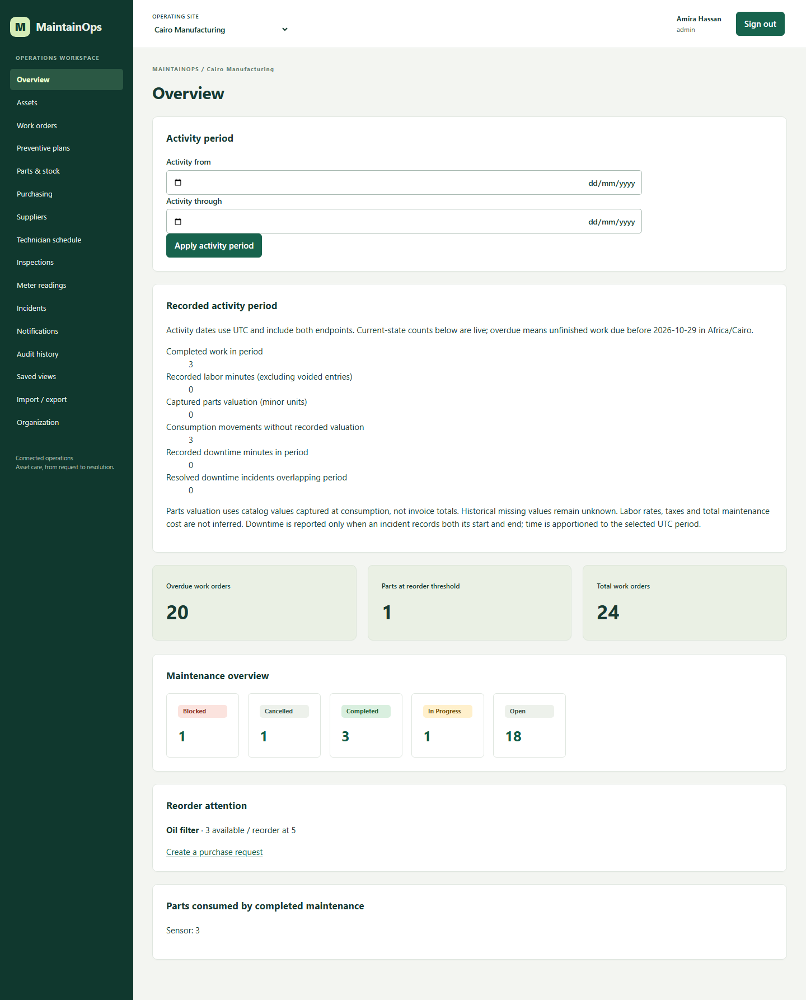
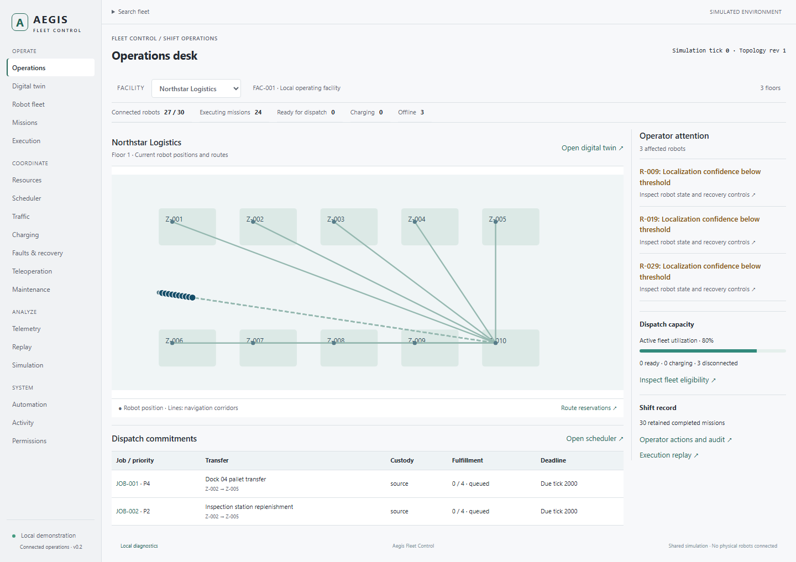
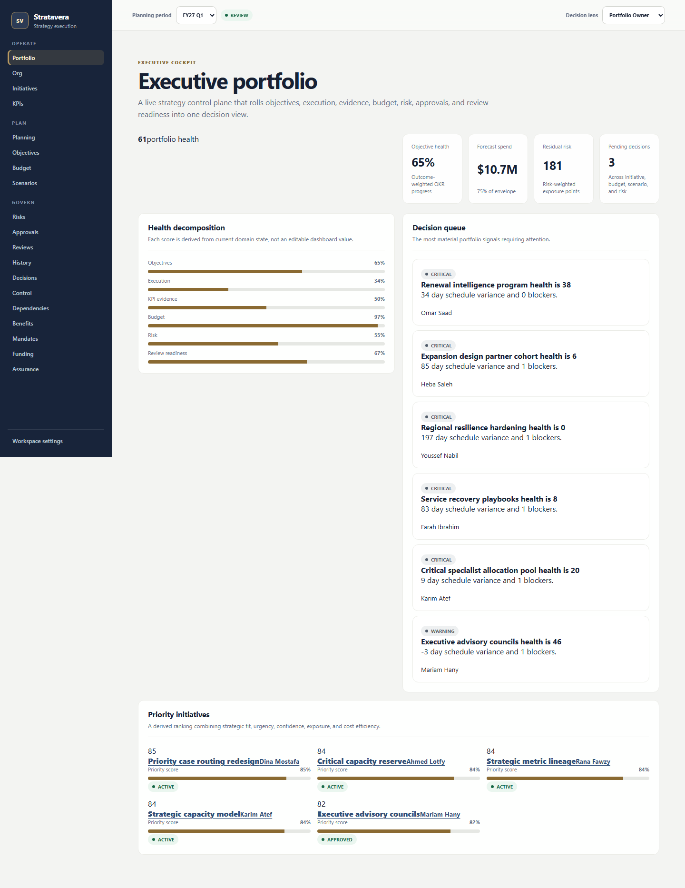

  

<strong>Python · JavaScript · TypeScript AI code review · Bug fixing · Benchmark design · Test automation</strong>

I'm Akram, a software engineer with **3+ years of software development and testing experience**. I build features, review and correct AI-generated code, reproduce bugs, and design benchmarks and automated tests that check whether a solution actually works.

My work spans **professional Python-based coding evaluation** and **JavaScript/TypeScript application engineering**. I have worked on programming and AI evaluation projects with AfterQuery, Turing AI, Outlier, and Alignerr.

  <a href="#ai-code-evaluation-and-benchmark-design">AI evaluation</a> ·
  <a href="#selected-projects">Projects and tests</a> ·
  <a href="#python-javascript-and-typescript">Languages</a> ·
  <a href="#how-i-review-a-generated-fix">Review workflow</a>

## AI code evaluation and benchmark design

- **Find and reproduce bugs:** turn an observed failure into a clear issue, expected behavior, and repeatable test case.
- **Review and correct generated code:** inspect logic, state transitions, authorization, error handling, and the effects of a proposed patch.
- **Design coding benchmarks:** define task requirements, reference fixes, failure cases, and behavioral checks that accept valid implementations.
- **Build automated tests:** use Python/pytest and TypeScript test suites for regression, integration, browser, and failure-path coverage.
- **Evaluate fixes:** check correctness, test adequacy, and regressions; explain defects and results with technical evidence.
- **Make evaluation reproducible:** use Git revisions, pinned dependencies, Docker environments, and fail-to-pass/pass-to-pass checks in my Python benchmark work.

## Selected projects

I use these repositories to test AI-generated code, identify and correct errors, and design debugging benchmarks. The links show the implementation and the concrete behaviors I test.

| Project | My code review and correction work | Benchmark and test evidence |
| --- | --- | --- |
| **[MaintainOps](https://github.com/Akrambadr99/maintainops)** | Corrected authentication and workflow behavior, including successful sign-ins consuming the failed-login allowance. | [Login throttling](https://github.com/Akrambadr99/maintainops/blob/main/tests/login-limits.test.ts) · [Atomic rollback and restart recovery](https://github.com/Akrambadr99/maintainops/blob/main/tests/persistence.test.ts) |
| **[FactoryOS](https://github.com/Akrambadr99/FactoryOS)** | Reviewed and corrected reservation and batch-release logic for atomicity, revision conflicts, and duplicate requests. | [SQLite fault injection and batch release](https://github.com/Akrambadr99/FactoryOS/blob/main/server/releaseBatchHttp.test.ts) · [Recovery and migrations](https://github.com/Akrambadr99/FactoryOS/blob/main/server/sqliteReservationStore.test.ts) |
| **[Taskora](https://github.com/Akrambadr99/Taskora)** | Reviewed React/TypeScript changes and corrected optimistic-update failures, revision conflicts, and duplicate submissions. | [Board rollback](https://github.com/Akrambadr99/Taskora/blob/main/src/app/pages/BoardPage.test.tsx) · [Drafts, permissions and interaction recovery](https://github.com/Akrambadr99/Taskora/blob/main/src/app/pages/IssueDetailPage.test.tsx) |
| **[Aegis Fleet Control](https://github.com/Akrambadr99/aegis-fleet-control)** | Evaluated and corrected fleet-simulation state, mission reservations, asynchronous validation, and stale writes. | [Storage, migration and recovery](https://github.com/Akrambadr99/aegis-fleet-control/blob/main/src/storage/PersistentStorageAdapter.test.ts) · [Validation races](https://github.com/Akrambadr99/aegis-fleet-control/blob/main/src/features/missions/ValidationRace.test.tsx) |
| **[Stratavera](https://github.com/Akrambadr99/AmberPath)** | Reviewed and corrected budget-transfer and approval logic for voting independence, permissions, and decision history. | [Approval renewals](https://github.com/Akrambadr99/AmberPath/blob/AmberPath/src/modules/approvals/renewal.test.ts) · [Funding-transfer integrity](https://github.com/Akrambadr99/AmberPath/blob/AmberPath/src/modules/funding-transfer/service.test.ts) |
| **[CareRoster](https://github.com/Akrambadr99/CareRoster)** | Reviewed and corrected staffing and credential logic, including stale approvals and required revalidation. | [Shift ledger and approval consistency](https://github.com/Akrambadr99/CareRoster/blob/main/src/staffing/coverage-matrix/shiftLedger.test.ts) · [Recovery behavior](https://github.com/Akrambadr99/CareRoster/blob/main/src/workspace/WorkflowRecovery.test.tsx) |
| **[LedgerSpring](https://github.com/Akrambadr99/CoralPoint)** | Reviewed and corrected reconciliation logic for duplicate statements, independent approval, and atomic adjustments. | [Reconciliation contracts](https://github.com/Akrambadr99/CoralPoint/blob/CoralPoint/src/reconciliation-control/reconciliation-control.test.ts) · [Archive recovery and evidence integrity](https://github.com/Akrambadr99/CoralPoint/blob/CoralPoint/src/period-governance/reporting-archive.test.ts) |

*Stratavera is hosted in `AmberPath`; LedgerSpring is hosted in `CoralPoint`. Several projects share foundation code and history. Their READMEs describe setup, test commands, and implementation scope.*

## Python, JavaScript and TypeScript

| Area | Experience and tools |
| --- | --- |
| **Python** | Coding-evaluation harnesses, reference patches, automation and data processing; pytest, FastAPI, pandas and NumPy. |
| **JavaScript / TypeScript** | Feature development, code review and debugging across React, Node.js, Express, SQLite, typed gateways and browser state. |
| **Testing and benchmarks** | Vitest, Testing Library, Playwright, pytest; regression cases, fault injection, concurrency, authorization and recovery checks. |
| **Development workflow** | Git, GitHub Actions, Docker, npm, Vite and ESLint; reproducible environments and reviewable changes. |

My independent Python work also includes **Netpulse / Pulseflow**, a network-monitoring tool with Docker packaging and automated tests used to review and correct AI-generated implementations.

For a public Python example, [car-speed-estimation](https://github.com/Akrambadr99/car-speed-estimation) explores YOLOv8 detection, OpenCV video processing, vehicle tracking, and line-crossing counts. It is an experimental computer-vision project; its speed labels are not calibrated measurements.

## How I review a generated fix

1. Reproduce the bug and define the expected behavior.
2. Inspect the generated patch and trace the affected code paths.
3. Correct logic errors and add a regression that exposes the original failure.
4. Check boundary conditions, failure paths, and related behavior.
5. Assess the solution against the task requirements and explain the outcome with code and test evidence.

## A look inside

Application captures using local fixture data.

<strong>MaintainOps · assets and maintenance execution</strong>

[Explore the repository](https://github.com/Akrambadr99/maintainops)

<strong>Aegis Fleet Control · simulated robot operations</strong>

[Explore the repository](https://github.com/Akrambadr99/aegis-fleet-control)

<strong>Taskora · projects and team workflows</strong>

[Explore the repository](https://github.com/Akrambadr99/Taskora)

<strong>Stratavera · strategy and portfolio decisions</strong>

[Explore the repository](https://github.com/Akrambadr99/AmberPath)

[Browse all repositories](https://github.com/Akrambadr99?tab=repositories)
